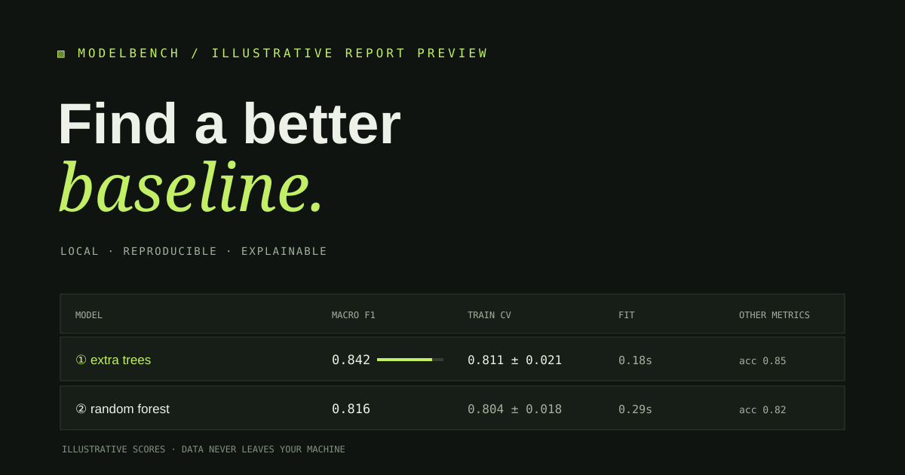

# ModelBench

**A local-first lab for comparing tabular ML models under the same reproducible split.** ModelBench profiles a CSV, imputes and encodes features inside each training pipeline, compares simple baselines, and writes a portable HTML or JSON report.



## Quick start

Requires Python 3.10 or later.

```bash
python -m pip install .
modelbench
```

The default run benchmarks the bundled synthetic subscription-retention dataset, predicts `churned`, and prints a terminal leaderboard. Create a self-contained report with optional cross-validation:

```bash
modelbench --cv 5 --format html --output reports/churn.html
```

Benchmark your own local CSV:

```bash
modelbench data/my-data.csv --target outcome --task classification --seed 17 --format html --output reports/my-run.html
```

For a numeric target, use `--task regression`. Machine-readable output is available with `--format json`. Use `--help` for the full CLI.

You can also run it from a checkout without installing the package:

```bash
PYTHONPATH=src python -m modelbench --cv 5
```

## Included baselines

| Task | Models | Primary ranking metric |
| --- | --- | --- |
| Classification | Majority baseline, logistic regression, random forest, extra trees | Macro F1 |
| Regression | Mean baseline, ridge regression, random forest, extra trees | R² |

Every run also reports useful secondary metrics, fit and prediction time, the holdout confusion matrix for classification, and the winning model's largest feature weights when the estimator exposes them. Tree feature importance and linear coefficient magnitude are signals for review; they are not causal explanations.

## Reproducibility and leakage control

A seeded train/holdout split is shared across all models. Missing-value imputation, numeric scaling, and categorical one-hot encoding are fitted inside each model pipeline on training rows only. Unknown categories in holdout rows are handled safely. Optional cross-validation runs on the training partition; it reports the mean and standard deviation of each model's fold scores.

The leaderboard selects a winner using the holdout set, so its score is a model comparison on that split, not an unbiased final estimate after selection. Use the fold results, another seed, and domain-specific validation before making a deployment decision. Read [the evaluation notes](docs/evaluation.md).

## Sample data

`src/modelbench/data/subscriptions.csv` is an 800-row fictional dataset generated deterministically with seed `20261017`. The target is generated from tenure, plan, support contacts, usage, and auto-pay with added noise. It is for demonstrating a workflow, not for drawing real customer conclusions.

Regenerate it with:

```bash
python data/generate_sample.py
```

See [the data dictionary](docs/data.md) for column meanings and synthetic-data limitations.

## Privacy

ModelBench reads a CSV path on your machine. It has no network calls, tracking, hosted service, or upload step. Reports include the dataset filename but do not include raw rows. Treat reports as project artifacts and review them before sharing.

## Stack

Python, pandas, NumPy, scikit-learn. The HTML report uses inline CSS and no external assets.

## License

MIT. See [LICENSE](LICENSE).
